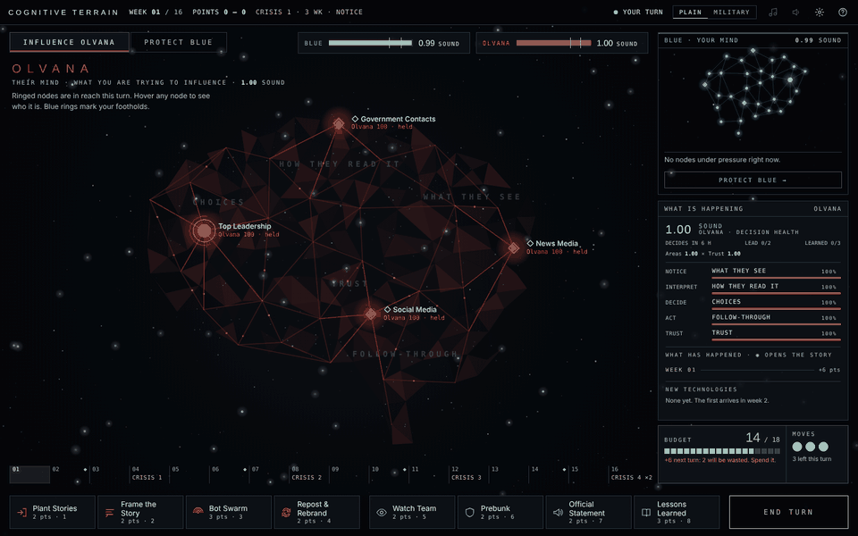

# Cognitive Terrain · Playtest downloads

**Play and download: https://kw-wargame.github.io/cognitive-terrain-releases-playtest/**

An educational, turn-based wargame of cognitive warfare: Blue vs Red (Olvana or Donovia).

| | |
|---|---|
| Play in your browser | [play/](play/) |
| Field manual (PDF) | [manual/Cognitive-Terrain-Field-Manual.pdf](manual/Cognitive-Terrain-Field-Manual.pdf) |
| Game as one HTML file | [cognitive-terrain-0.14.2.html](https://github.com/KW-Wargame/cognitive-terrain-releases-playtest/releases/download/v0.14.2/cognitive-terrain-0.14.2.html) |
| Installers and every earlier version | [Releases](https://github.com/KW-Wargame/cognitive-terrain-releases-playtest/releases) |

This repository holds released builds only. © 2026 Kevin Williamson. All rights reserved.
